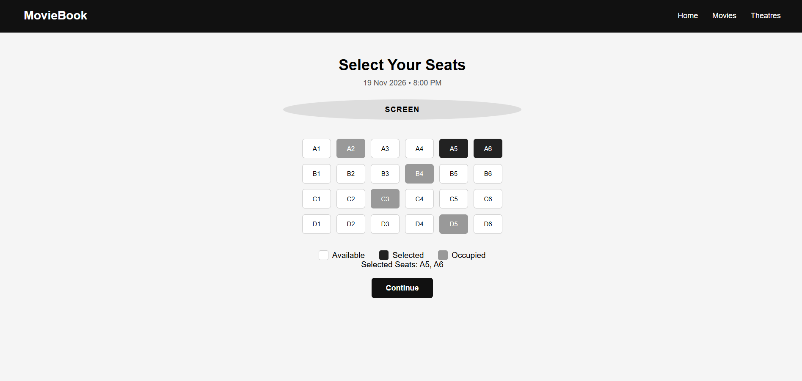
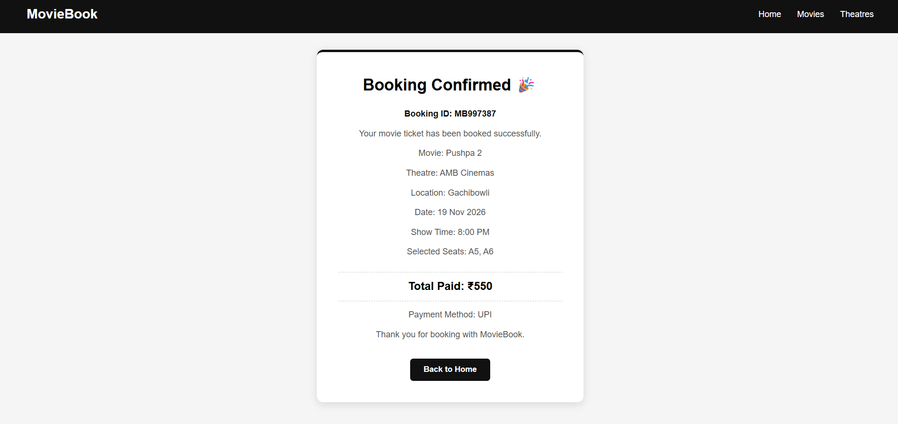

# MovieBook - Movie Ticket Booking System

A movie ticket booking web app built with React. Users can browse movies, choose a theatre, date and showtime, pick seats, review the price and complete a simulated payment to get a booking confirmation.

**Live Demo:** https://rajeev-2024.github.io/movie-ticket-booking/

## Features

- Home page with a movie list, search by title and a genre filter
- Movie details page
- Theatre selection with four sample theatres
- Date and showtime selection
- Seat selection on a 24-seat layout (rows A to D), with available, selected and occupied seats
- Seat pricing by row: Rs. 250 for rows A and B, Rs. 180 for rows C and D
- Booking summary with ticket price, 10% convenience fee and total
- Payment method selection (UPI, Card, Net Banking)
- Booking confirmation with a generated booking ID
- Reusable components (`Navbar`, `MovieCard`) and page-based routing

Payment is simulated for demonstration. No real payment is processed and no data is sent to a server.

## Tech Stack

- React 19
- React Router (HashRouter, so routes work on GitHub Pages)
- Vite
- JavaScript, HTML5, CSS3
- JSON files for movies, theatres and showtimes
- GitHub Pages for hosting

## Booking Flow

Home -> Movie Details -> Theatre Selection -> Showtimes -> Seat Selection -> Booking Summary -> Payment -> Confirmation

Booking details are passed between pages using React Router state.

## Project Structure

```
src/
  assets/movies/        movie posters
  components/
    MovieCard/
    Navbar/
  data/
    movies.json
    theatres.json
    shows.json
    movieImages.js
  pages/
    Home/
    MovieDetails/
    TheatreSelection/
    ShowTimes/
    SeatSelection/
    BookingSummary/
    Payment/
    BookingConfirmation/
  App.jsx
  main.jsx
```

## Getting Started

Requirements: Node.js 18 or later.

```bash
git clone https://github.com/Rajeev-2024/movie-ticket-booking.git
cd movie-ticket-booking
npm install
npm run dev
```

Open the local URL shown in the terminal (usually http://localhost:5173).

## Available Scripts

| Command | What it does |
| --- | --- |
| `npm run dev` | Starts the development server |
| `npm run build` | Creates a production build in `dist` |
| `npm run preview` | Previews the production build locally |
| `npm run lint` | Runs ESLint |
| `npm run deploy` | Builds and publishes to the `gh-pages` branch |

## Deployment

The app is deployed to GitHub Pages with the `gh-pages` package. `vite.config.js` sets `base: '/movie-ticket-booking/'` and the app uses `HashRouter`, so pages load correctly under the repository path.

## Future Improvements

- User login and registration
- Backend API and database for movies, shows and bookings
- Real seat availability that updates after each booking
- Booking history

## Screenshots





## Author

**A Rajeev**
- GitHub: [Rajeev-2024](https://github.com/Rajeev-2024)
- LinkedIn: [a-rajeev](https://www.linkedin.com/in/a-rajeev-72a9023ba)
